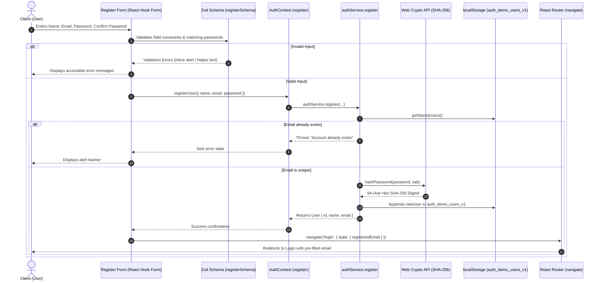
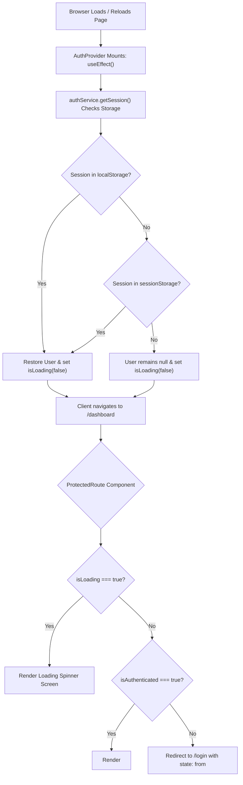

# Complete Architectural Guide & Codebase Reference

> **Project:** SecureAuth — Enterprise-Grade React & TypeScript Authentication System  
> **Author:** Antigravity Engineering Reference  
> **Target Audience:** Developers, Technical Interviewers, System Architects  

---

## 📑 Table of Contents

1. [High-Level Architecture & Mental Model](#1-high-level-architecture--mental-model)
2. [End-to-End System Workflows (How the Project Works)](#2-end-to-end-system-workflows-how-the-project-works)
   - [2.1 Registration Workflow](#21-registration-workflow)
   - [2.2 Login & Session Management Workflow](#22-login--session-management-workflow)
   - [2.3 Route Guarding & Reload Restoration](#23-route-guarding--reload-restoration)
   - [2.4 User-Specific Theme Synchronization](#24-user-specific-theme-synchronization)
   - [2.5 Interactive Matrix Canvas Pipeline](#25-interactive-matrix-canvas-pipeline)
3. [Exhaustive File-by-File & Function-by-Function Breakdown](#3-exhaustive-file-by-file--function-by-function-breakdown)
   - [3.1 Application Bootstrap & Shell](#31-application-bootstrap--shell)
   - [3.2 Type Definitions (`src/types/`)](#32-type-definitions-srctypes)
   - [3.3 Pure Utilities (`src/utils/`)](#33-pure-utilities-srcutils)
   - [3.4 Data & Persistence Services (`src/services/`)](#34-data--persistence-services-srcservices)
   - [3.5 Global State Management (`src/context/`)](#35-global-state-management-srccontext)
   - [3.6 Reusable UI Components (`src/components/`)](#36-reusable-ui-components-srccomponents)
   - [3.7 Application Views & Pages (`src/pages/`)](#37-application-views--pages-srcpages)
   - [3.8 Configuration & Build Files](#38-configuration--build-files)
4. [Security & Cryptographic Deep Dive](#4-security--cryptographic-deep-dive)
5. [Future Roadmap & Production Scaling](#5-future-roadmap--production-scaling)

---

## 1. High-Level Architecture & Mental Model

The application follows a **Decoupled Layered Architecture**, establishing strict unidirectional data flow and strong separation of concerns:

```
┌─────────────────────────────────────────────────────────────┐
│                       Presentation Layer                    │
│   (Pages: Login, Register, ForgotPassword, Dashboard)       │
└──────────────────────────────┬──────────────────────────────┘
                               │ Dispatches Actions / Reads State
                               ▼
┌─────────────────────────────────────────────────────────────┐
│                    State & Context Layer                    │
│        (AuthProvider: Auth State | ThemeProvider: Theme)     │
└──────────────┬───────────────────────────────┬──────────────┘
               │ Calls Data Layer              │ Reads / Writes DOM
               ▼                               ▼
┌──────────────────────────────┐ ┌─────────────────────────────┐
│       Service Layer          │ │         DOM Root            │
│      (authService.ts)        │ │  (<html data-theme="...">)  │
└──────────────┬───────────────┘ └─────────────────────────────┘
               │ Uses Pure Helpers
               ▼
┌─────────────────────────────────────────────────────────────┐
│                    Pure Utility Layer                       │
│ (validation.ts | passwordStrength.ts | passwordGenerator.ts) │
└──────────────┬──────────────────────────────────────────────┘
               │ Hardware Cryptography
               ▼
┌─────────────────────────────────────────────────────────────┐
│               Browser Web Crypto API & Storage              │
│ (crypto.subtle | crypto.getRandomValues | Local/Session)    │
└─────────────────────────────────────────────────────────────┘
```

### Core Architecture Highlights:
1. **Zero Global Bleed:** All state changes propagate exclusively through typed React Contexts (`AuthContext`, `ThemeContext`).
2. **Schema-Driven Invariant Guarantee:** Zod schemas act as strict firewalls ensuring no corrupt data reaches the service or persistence layer.
3. **Pluggable Persistence:** `authService` encapsulates all storage mechanics. Migrating from `localStorage` to a REST or GraphQL backend requires zero UI component rewrites.
4. **Hardware Cryptography:** All random selections and hash calculations execute through the native browser `crypto` subsystem.

---

## 2. End-to-End System Workflows (How the Project Works)

### 2.1 Registration Workflow



### 2.2 Login & Session Management Workflow

1. User enters email, password, and selects whether to keep **"Remember me"** enabled.
2. `useForm` resolves inputs against `loginSchema`.
3. `authService.login` normalizes the email to lowercase and searches `localStorage.getItem('auth_demo_users_v1')`.
4. If found, the input password is salt-hashed via `crypto.subtle.digest('SHA-256', ...)`.
5. The resulting hex digest is compared against the stored `passwordHash`:
   - **Mismatch:** Generic error `"Invalid email or password."` thrown to prevent email enumeration.
   - **Match:** Generates a `SessionData` payload (`{ user, rememberMe, loginAt }`).
6. **Session Storage Route:**
   - If `rememberMe === true`: Saved to `localStorage.setItem('auth_demo_session_v1', ...)`.
   - If `rememberMe === false`: Saved to `sessionStorage.setItem('auth_demo_session_v1', ...)`.
7. `AuthContext` updates its `user` state, and the router directs the client to `/dashboard`.

### 2.3 Route Guarding & Reload Restoration



### 2.4 User-Specific Theme Synchronization

Unlike basic theme toggles that store a single global string, this application synchronizes themes on an **Account Level**:
1. When no user is authenticated, the root `<html>` attribute `data-theme` relies on `auth_app_theme_mode` (Device default or OS preference).
2. When User A logs in, `ThemeContext` detects `user?.id` and inspects `localStorage.getItem('auth_user_theme_' + user.id)`. If present, the app switches to User A's preferred theme.
3. If User A toggles the theme, `ThemeContext` writes to both the global device key and `auth_user_theme_${user.id}`.
4. When User A logs out and User B logs in, the hook detects the new ID and instantly adapts the interface to User B's preferred theme.

### 2.5 Interactive Matrix Canvas Pipeline

1. `MatrixBackground` mounts an HTML5 `<canvas>` covering `100vw × 100vh` behind all views (`z-index: 0`).
2. Calculates high-DPI scaling using `window.devicePixelRatio` to prevent blurry text on Retina displays.
3. Generates a cellular grid of size `width / 34px` by `height / 34px`.
4. An animation loop powered by `requestAnimationFrame` calculates:
   - Proximity to mouse cursor: Euclidean distance $d = \sqrt{(x - x_m)^2 + (y - y_m)^2}$.
   - If $d < \text{radius}$, the cell activates a smooth 3D vertical flip transition and illuminates with high opacity terracotta glow.
   - Periodic random flips occur across distant cells to simulate cyber rain / digital data streams.

---

## 3. Exhaustive File-by-File & Function-by-Function Breakdown

```
auth_ui/
├── src/
│   ├── types/
│   │   └── auth.ts
│   ├── utils/
│   │   ├── validation.ts
│   │   ├── passwordStrength.ts
│   │   └── passwordGenerator.ts
│   ├── services/
│   │   └── authService.ts
│   ├── context/
│   │   ├── AuthContext.tsx
│   │   └── ThemeContext.tsx
│   ├── components/
│   │   ├── AuthLayout.tsx
│   │   ├── Button.tsx
│   │   ├── FormInput.tsx
│   │   ├── PasswordInput.tsx
│   │   ├── PasswordStrengthMeter.tsx
│   │   ├── PasswordGenerator.tsx
│   │   ├── MatrixBackground.tsx
│   │   ├── ThemeToggle.tsx
│   │   └── ProtectedRoute.tsx
│   ├── pages/
│   │   ├── Login.tsx
│   │   ├── Register.tsx
│   │   ├── ForgotPassword.tsx
│   │   └── Dashboard.tsx
│   ├── App.tsx
│   ├── main.tsx
│   ├── index.css
│   └── vite-env.d.ts
├── index.html
├── package.json
├── tsconfig.json
└── vite.config.ts
```

---

### 3.1 Application Bootstrap & Shell

#### `src/main.tsx`
- **Purpose:** Entry point where React initializes and mounts into the DOM.
- **Key Code Mechanics:**
  - Imports `React.StrictMode` to activate runtime checks and identify legacy lifecycle side-effects during development.
  - Targets `document.getElementById('root')!`.
  - Imports global styling (`import './index.css'`).

#### `src/App.tsx`
- **Purpose:** Central component tree orchestrating providers and route definitions.
- **Provider Architecture:**
  - Wraps the entire hierarchy inside `<BrowserRouter>`.
  - Wraps `<AuthProvider>` outside `<ThemeProvider>`, enabling `ThemeProvider` to hook into user login states for personal theme persistence.
- **Declared Routes:**
  - `/login` $\rightarrow$ `<Login />`
  - `/register` $\rightarrow$ `<Register />`
  - `/forgot-password` $\rightarrow$ `<ForgotPassword />`
  - `/dashboard` $\rightarrow$ Wrapped inside `<ProtectedRoute><Dashboard /></ProtectedRoute>`
  - `*` $\rightarrow$ Catch-all redirecting to `/dashboard`.

#### `src/index.css`
- **Purpose:** Master stylesheet defining the design tokens, glassmorphic filters, and responsive rules.
- **Core Sections:**
  - `@import "tailwindcss";` — Integrates Tailwind CSS v4.
  - `:root` vs `[data-theme="dark"]` tokens — Coordinates terracotta `#D97757` and obsidian dark surfaces `#131110`.
  - `.matrix-canvas` & `.matrix-glow-overlay` — Fixed full-screen backdrop.
  - Responsive Breakpoints (`@media (max-width: 768px)`, `@media (max-width: 640px)`, `@media (max-width: 480px)`).

---

### 3.2 Type Definitions (`src/types/auth.ts`)

Centralized contract file ensuring 100% strict type safety across the entire application:

| Interface / Type | Purpose | Properties |
| :--- | :--- | :--- |
| `User` | Public identity of a signed-in client | `id: string`, `name: string`, `email: string` |
| `StoredUser` | Record written to persistent storage | Extends `User` with `passwordHash: string`, `createdAt: string` |
| `SessionData` | Payload stored in storage sessions | `user: User`, `rememberMe: boolean`, `loginAt: string` |
| `AuthContextType` | Signature exposed by `useAuth()` | `user`, `isAuthenticated`, `isLoading`, `error`, `login()`, `register()`, `logout()`, `requestPasswordReset()` |
| `ThemeContextType` | Signature exposed by `useTheme()` | `theme: 'light' \| 'dark'`, `isDark: boolean`, `toggleTheme()` |
| `Requirement` | Password rule for real-time validation | `id: string`, `label: string`, `met: boolean` |
| `PasswordAnalysis` | Full output of password audit engine | `score`, `label`, `color`, `requirements`, `issues`, `crackEffort`, `suggestion` |

---

### 3.3 Pure Utilities (`src/utils/`)

#### `src/utils/validation.ts`
- **Purpose:** Pure schema validation using Zod for client input integrity.
- **Exported Schemas & Inferred Types:**
  - `loginSchema`:
    - `email`: Required, valid email format.
    - `password`: Required non-empty string.
    - `rememberMe`: Boolean flag.
    - Inferred Type: `LoginFormData`.
  - `registerSchema`:
    - `name`: Min 2, Max 50 characters.
    - `email`: Required, email format.
    - `password`: Min 8 characters, regex checks for 1 uppercase, 1 lowercase, 1 digit, 1 special symbol.
    - `confirmPassword`: Validates matching `password` via `.refine()`.
    - Inferred Type: `RegisterFormData`.
  - `forgotPasswordSchema`:
    - `email`: Required, email format.
    - Inferred Type: `ForgotPasswordFormData`.

#### `src/utils/passwordStrength.ts`
- **Purpose:** Enterprise entropy analyzer and pattern detection engine.
- **Functions:**
  1. `checkRequirements(password: string): Requirement[]`
     - Evaluates 5 rules: $\ge 8$ chars, lowercase, uppercase, numeric, special symbol.
  2. `detectPatterns(password: string): string[]`
     - Matches against common dictionaries (`COMMON_PATTERNS` like `password`, `123456`, `admin`).
     - Detects repeating identical characters ($\ge 4$, e.g., `aaaa`).
     - Detects keyboard sequences ($\ge 4$ consecutive characters like `qwer`, `0123`).
  3. `estimateCrackEffort(password: string): string`
     - Computes character pool size $R$: Lowercase (26) + Uppercase (26) + Digits (10) + Symbols (33).
     - Calculates entropy bits:
       $$\text{Entropy (bits)} = L \times \log_2(R)$$
     - Maps bits to human crack time (from *"Instantly"* to *"Centuries"*).
  4. `evaluatePasswordStrength(password: string): PasswordAnalysis`
     - Aggregates met requirements, deducts penalties for pattern vulnerabilities, and returns a tier score from 0 (*Very Weak*) to 4 (*Very Strong*).

#### `src/utils/passwordGenerator.ts`
- **Purpose:** Cryptographically Secure Pseudo-Random Number Generator (CSPRNG).
- **Functions:**
  1. `getSecureRandomInt(max: number): number`
     - Uses `window.crypto.getRandomValues(new Uint32Array(1))`.
     - Implements **Unbiased Rejection Sampling** to eliminate modulo bias.
  2. `secureShuffle<T>(array: T[]): T[]`
     - Fisher-Yates shuffle driven by `getSecureRandomInt`.
  3. `generatePassword(options: PasswordGeneratorOptions): string`
     - Guaranteed inclusion: takes one character from each selected charset.
     - Fills remaining length from the merged pool using secure random sampling.
     - Final result undergoes `secureShuffle` so guaranteed characters do not appear in predictable initial positions.
  4. `generatePassphrase(wordCount: number, separator: string): string`
     - Selects from a curated 72-word EFF Diceware wordlist, joining them with hyphens.

---

### 3.4 Data & Persistence Services (`src/services/authService.ts`)

- **Purpose:** Mock backend service simulating asynchronous network latency, client-side cryptography, and persistent storage.
- **Internal Helper Functions:**
  - `hashPassword(password: string, salt?: string): Promise<string>`
    - Encodes salt + password into a UTF-8 `Uint8Array`.
    - Computes digest using `crypto.subtle.digest('SHA-256', data)`.
    - Formats 32-byte buffer into a 64-character hexadecimal string.
  - `getStoredUsers(): StoredUser[]`
    - Parses `localStorage.getItem('auth_demo_users_v1')`.
  - `saveStoredUsers(users: StoredUser[]): void`
    - Serializes user array back to `localStorage`.
  - `seedDemoUserIfNeeded(): Promise<void>`
    - Seeds default user `alex.morgan@example.com` (password: `Password123!`) if storage is empty.
- **Exported `authService` Methods:**
  - `register({ name, email, password })`: Checks email collision, computes salted SHA-256 hash, stores record, returns public `User`.
  - `login({ email, password, rememberMe })`: Verifies email and salted SHA-256 hash, records active session in either `localStorage` or `sessionStorage`.
  - `logout()`: Clears session records from both storages.
  - `getSession(): Promise<User | null>`: Checks for active, unexpired session payloads and returns the authenticated user.
  - `requestPasswordReset({ email })`: Generates mock reset token to simulate secure email recovery flows.

---

### 3.5 Global State Management (`src/context/`)

#### `src/context/AuthContext.tsx`
- **Purpose:** React Context providing authentication state across the entire application tree.
- **State Managed:**
  - `user: User | null` — Currently signed-in user.
  - `isLoading: boolean` — Indicates ongoing session restoration.
  - `error: string | null` — Top-level authentication error.
- **Key Methods:**
  - `login(...)`: Invokes `authService.login`, updates local state on success.
  - `register(...)`: Invokes `authService.register`.
  - `logout()`: Clears credentials and resets user state to `null`.
  - `requestPasswordReset(...)`: Dispatches reset request to the service layer.
- **Custom Hook:**
  - `useAuth()`: Consumes context and throws an informative runtime error if used outside `<AuthProvider>`.

#### `src/context/ThemeContext.tsx`
- **Purpose:** Theme management with dual-layer (device + account-level) persistence.
- **State Managed:**
  - `theme: 'light' | 'dark'`
  - `isDark: boolean`
- **Key Mechanics:**
  - Reads active user from `useAuth()`.
  - Listens to changes in `user?.id`: If the authenticated user has a personalized theme preference (`auth_user_theme_${user.id}`), automatically switches to it.
  - On theme toggle: writes to both device fallback key (`auth_app_theme_mode`) and per-user storage key.
  - Sets `data-theme` on `document.documentElement` to trigger CSS custom property shifts.

---

### 3.6 Reusable UI Components (`src/components/`)

#### `src/components/AuthLayout.tsx`
- **Purpose:** Reusable frosted glass wrapper for authentication pages.
- **Props:** `children`, `title`, `subtitle`, `icon: ComponentType`, `footer?: ReactNode`.
- **Features:** Renders interactive `MatrixBackground`, glow ambient lighting, brand logo badge, header typography, and footer navigation links.

#### `src/components/Button.tsx`
- **Purpose:** Accessible polymorphic button with loading states.
- **Props:** Extends standard `ButtonHTMLAttributes<HTMLButtonElement>` with `variant ('primary' | 'secondary' | 'ghost')`, `isFullWidth`, `isLoading`, `loadingText`.
- **Features:** Renders animated `Loader2` spinner when `isLoading` is true, automatically setting `aria-busy="true"` and `disabled`.

#### `src/components/FormInput.tsx`
- **Purpose:** Accessible form input with integrated labeling, leading icons, error validation, and hints.
- **Implementation:** Built using `forwardRef<HTMLInputElement, FormInputProps>` for seamless compatibility with React Hook Form's `register`.
- **Accessibility:** Generates unique IDs via `useId()`, connects errors via `aria-describedby` and `aria-invalid`.

#### `src/components/PasswordInput.tsx`
- **Purpose:** Password field featuring an integrated visibility toggle (Show/Hide) and optional quick-action slot.
- **Implementation:** Wraps `FormInput` with an internal `showPassword` boolean state toggling between `type="password"` and `type="text"`.
- **Slots:** Supports `headerRightAction` for embedding the *"Generate Password"* button directly in the input label row.

#### `src/components/PasswordStrengthMeter.tsx`
- **Purpose:** Live visual indicator reflecting password complexity.
- **Features:**
  - Evaluates password strength via `useMemo(() => evaluatePasswordStrength(password))`.
  - Renders a 4-segment progress bar with dynamic color transitions.
  - Displays check/cross checklist for length, uppercase, lowercase, numbers, and symbols.
  - Displays estimated offline crack resistance time.

#### `src/components/PasswordGenerator.tsx`
- **Purpose:** Interactive password generation modal/card.
- **Controls:**
  - Mode switcher: Random Characters vs 4-Word Diceware Passphrase.
  - Slider: Length selector (8 to 32 characters).
  - Checkboxes: Uppercase, Lowercase, Numbers, Symbols.
  - Buttons: Regenerate (`RefreshCw`), Copy to Clipboard (`Copy`), Apply to Form (`Use This Password`).

#### `src/components/MatrixBackground.tsx`
- **Purpose:** HTML5 Canvas cyber matrix particle animation.
- **Mechanics:** 2D canvas animation tracking pointer coordinates with high-DPI retina display adaptation. Cells within cursor radius flip vertically and illuminate with terracotta glow.

#### `src/components/ThemeToggle.tsx`
- **Purpose:** Floating or embedded button toggling Light and Dark themes.
- **Icons:** Animated Sun / Moon transitions with rotation hover effects.

#### `src/components/ProtectedRoute.tsx`
- **Purpose:** Route security barrier.
- **Mechanics:** Inspects `isLoading` and `isAuthenticated` from `useAuth()`. While loading, displays a branded loading screen. If unauthenticated, redirects to `/login` preserving the intended URL via `state.from`.

---

### 3.7 Application Views & Pages (`src/pages/`)

#### `src/pages/Login.tsx`
- **Route:** `/login`
- **Features:**
  - Sign-in form with email, password, and "Remember me" checkbox.
  - Automatically receives pre-filled email when navigated from the registration screen.
  - Captures authentication failures and renders accessible alert banners.

#### `src/pages/Register.tsx`
- **Route:** `/register`
- **Features:**
  - Full registration form with Name, Email, Password, and Confirm Password.
  - Live password strength meter renders beneath the password field.
  - Embedded Password Generator drawer automatically synchronizes generated values into both password fields.

#### `src/pages/ForgotPassword.tsx`
- **Route:** `/forgot-password`
- **Features:**
  - Password recovery request form.
  - Simulates secure recovery instructions with return-to-login navigation.

#### `src/pages/Dashboard.tsx`
- **Route:** `/dashboard` (Guarded)
- **Features:**
  - Sticky glassmorphic navbar with brand identity, user badge, theme toggle, and logout button.
  - Hero welcome banner displaying client name.
  - Account Profile card presenting user metadata (Name, Email, UUID, and Web Crypto security protocol).

---

### 3.8 Configuration & Build Files

- **`vite.config.ts`**: Configures Vite with `@vitejs/plugin-react` and `@tailwindcss/vite`.
- **`tsconfig.json`**: TypeScript compiler configuration enforcing `strict: true`, `noEmit: true`, `moduleResolution: "bundler"`, and `target: "ES2022"`.
- **`package.json`**: Declares dependencies (`react`, `react-router-dom`, `react-hook-form`, `zod`, `lucide-react`, `tailwindcss`) and npm build scripts.
- **`.oxlintrc.json`**: Configuration for Oxlint high-performance JavaScript/TypeScript linter.

---

## 4. Security & Cryptographic Deep Dive

### 4.1 Why Web Crypto API Over `Math.random()`?

`Math.random()` is a pseudo-random number generator (PRNG) that is deterministic and vulnerable to state reconstruction attacks. In this project:
- All random choices rely on `window.crypto.getRandomValues()`.
- To avoid **Modulo Bias** when selecting from character sets of arbitrary lengths, `getSecureRandomInt()` computes a rejection limit:

```typescript
const maxUint = 0xffffffff
const limit = maxUint - (maxUint % max)
do {
  crypto.getRandomValues(randomBuffer)
  randomVal = randomBuffer[0]
} while (randomVal >= limit)
return randomVal % max
```

### 4.2 Salted SHA-256 Client-Side Hashing

Client passwords are never stored in plaintext. While client-side hashing is not a complete replacement for server-side key derivation functions (like Argon2id or bcrypt), it ensures:
1. Zero plaintext exposure in browser developer tools or storage snapshots.
2. Protection against rainbow table lookups through static application salt salting:
   $$\text{Hash} = \text{SHA-256}(\text{salt} \parallel \text{password})$$

---

## 5. Future Roadmap & Production Scaling

Here are the logical next steps for upgrading this client-side architecture into a production-grade enterprise system:

```
┌────────────────────────────────────────────────────────┐
│                   Future Scaling Roadmap               │
└──────────────────────────────────┬─────────────────────┘
                                   │
      ┌────────────────────────────┼────────────────────────────┐
      ▼                            ▼                            ▼
[Backend Integration]      [Advanced Security]       [Testing & Quality]
  • REST / GraphQL API       • Passkeys (WebAuthn)     • Unit Tests (Vitest)
  • Node / Go Microservices  • TOTP 2FA (Authenticator)• E2E (Playwright)
  • PostgreSQL / Prisma      • Rate Limiting / Redis   • Accessibility (a11y)
  • HttpOnly Cookies / JWT   • Email Verification      • CI/CD Pipeline
```

### 1. Real Backend & Database Integration
- Replace `authService.ts` local storage calls with `fetch` / `axios` endpoints communicating with a backend API (Node.js, NestJS, Go, or Python FastAPI).
- Implement database storage (PostgreSQL, MongoDB) with password hashing handled on the server using **Argon2id** or **bcrypt** with individual cryptographic salts.

### 2. Cookie-Based JWT & Refresh Token Rotation
- Eliminate local storage token storage to protect against Cross-Site Scripting (XSS).
- Use **`HttpOnly`**, **`Secure`**, and **`SameSite=Strict`** cookies to transport short-lived access tokens (15 mins) and rotatable refresh tokens.

### 3. Multi-Factor Authentication (MFA / 2FA)
- **TOTP (Time-Based One-Time Password):** Integrate Google Authenticator / Authy support with QR code pairing.
- **Biometric Passkeys (WebAuthn / FIDO2):** Allow users to sign in with TouchID, FaceID, or hardware security keys (YubiKey).

### 4. Brute-Force Defense & Rate Limiting
- Implement progressive exponential backoff (e.g., 1s, 2s, 4s, 8s lockouts after failed login attempts).
- Integrate Cloudflare Turnstile or reCAPTCHA v3 after 3 failed password attempts.

### 5. Automated Testing Suite
- **Unit & Integration Tests:** Set up **Vitest** and **React Testing Library** to test form validation, password strength calculations, and context state transitions.
- **End-to-End (E2E) Tests:** Configure **Playwright** to execute automated browser testing across Chromium, Firefox, and WebKit on desktop and mobile viewports.

### 6. Internationalization (i18n)
- Introduce `react-i18next` to support multi-language localizations (English, Tamil, Spanish, German) with dynamic language switching in the dashboard.

